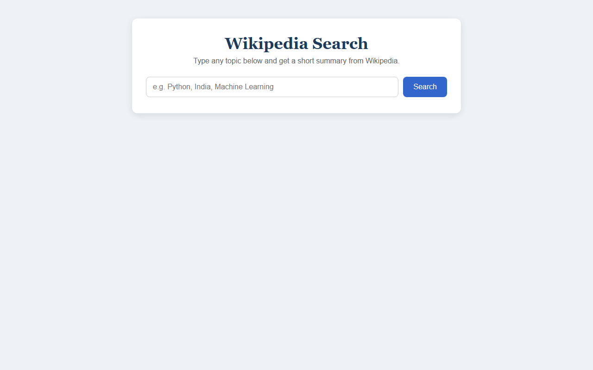
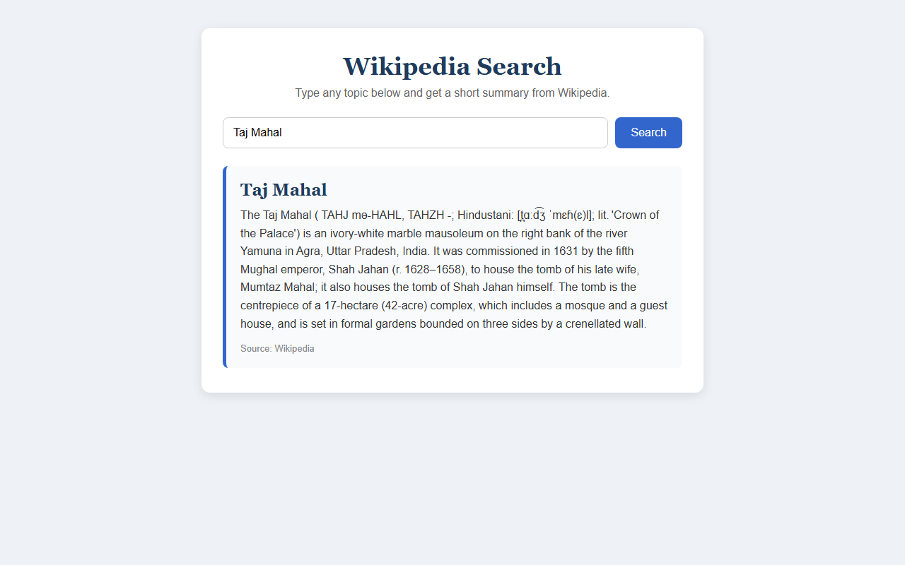
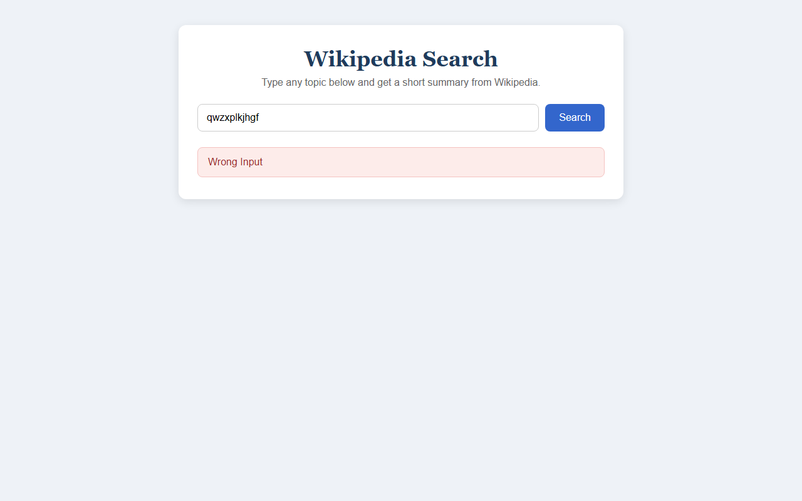
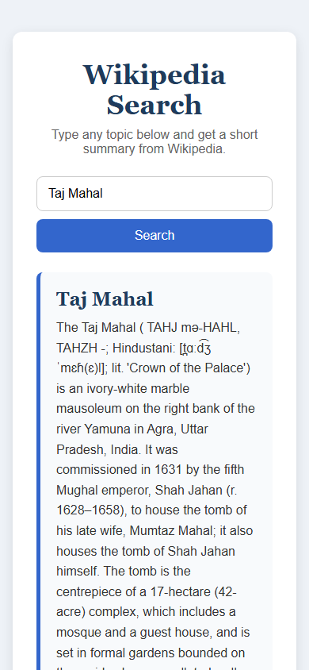

# Wikipedia Search App using Django

## Project Description

A simple web application built with Django where the user types a topic into a search box and gets a short summary (3 sentences) of that topic from Wikipedia. The summary is shown on the same page. If the search box is empty or no matching article is found, a friendly error message is shown instead.

## Features

- Simple search page with a text box and a Search button
- Fetches a 3-sentence summary of the topic from Wikipedia
- Shows the summary in a styled result card with the article title
- Friendly error messages for an empty search, unknown topics, and topics with many meanings
- Clean design made with plain HTML and CSS only
- Works on both desktop and mobile screens

## Technologies Used

- Python
- Django
- Wikipedia Python Library (`wikipedia`)
- HTML
- CSS

## Screenshots

### Home Page

The search page as it first loads.



### Search Result

Searching for "Taj Mahal" shows a 3-sentence summary from Wikipedia in a result card.



### Error Message

Searching for a topic that doesn't exist shows an error message.



### Mobile View

On small screens, the Search button moves below the text box.



## Project Structure

```text
wikipedia_app/
├── manage.py                  # Command-line tool to run the project
├── wikipedia_app/             # Project settings folder
│   ├── settings.py            # Settings (installed apps, templates, static files)
│   └── urls.py                # Main URLs, includes the URLs of the main app
├── main/                      # The Django app
│   ├── views.py               # home view: reads the search and calls Wikipedia
│   ├── urls.py                # Maps the homepage "/" to the home view
│  
├── templates/
│   └── main/
│       └── index.html         # The webpage (form, result, error message)
├── static/
│   └── main/
│       └── style.css          # All the styling of the page
├── screenshots/               # Screenshots used in this README
├── requirements.txt           # Required Python packages
├── .gitignore                 # Files Git should ignore
└── README.md
```

## Working

```text
User enters topic
        ↓
HTML form sends POST request
        ↓
Django view receives search term
        ↓
Wikipedia Python library searches Wikipedia
        ↓
Summary is returned
        ↓
Django sends result to HTML
        ↓
Result is displayed on webpage
```


